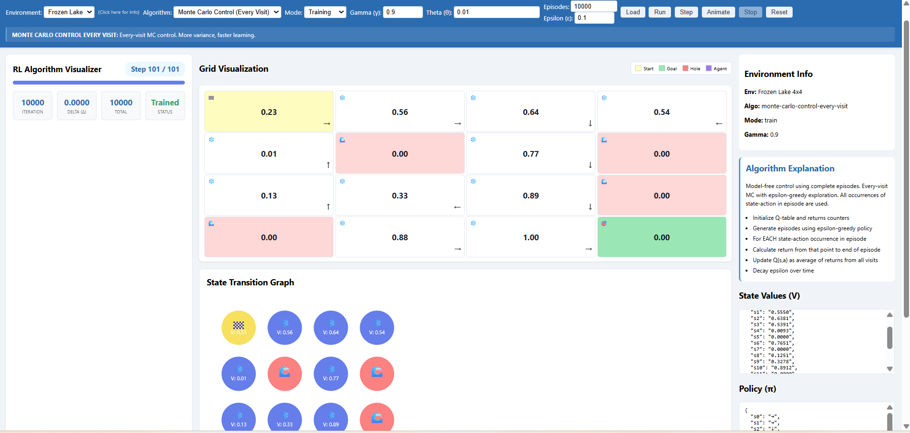

# Interactive Reinforcement Learning Algorithm Visualizer

**From Theory to Practice: Watching Algorithms Learn**

An interactive, browser-based learning tool that implements six classic reinforcement learning algorithms from scratch and visualizes how they learn, step by step. Change the parameters, switch environments, and watch values, policies and the agent's behavior evolve in real time.

Built with vanilla JavaScript and D3.js. There is no backend and no build step.



## Features

- **Six algorithms, implemented from scratch** (no RL libraries)
  - Model-based: Value Iteration, Policy Iteration
  - Model-free: SARSA, Q-Learning, Monte Carlo Control (First-Visit), Monte Carlo Control (Every-Visit)
- **Two environments**
  - **GridWorld 3×3:** stochastic transitions (80% intended move, 20% stay in place), -1 per step, +100 at the goal
  - **Frozen Lake 4×4:** deterministic transitions, 4 terminal holes (-1), +1 at the goal
- **Training and Inference modes:** train an agent, then press **Play** to watch it act in the environment with live step, state, action and reward tracking
- **Step-by-step control:** Run, Step, Animate, Stop and Reset buttons
- **Live visualizations**
  - Grid view with state colors, policy arrows and agent position
  - State-transition graph rendered with D3.js
  - State values (V), policy (π), execution log, progress bar and statistics (iteration, delta Δ, status)
- **Tunable hyperparameters:** discount factor γ, convergence threshold θ, episodes, exploration rate ε (with decay) and learning rate α. The relevant inputs are shown or hidden depending on the selected algorithm, and tooltips suggest value ranges.
- **Built-in explanations:** each algorithm comes with a short description and a breakdown of its steps in the side panel

## Algorithms at a glance

| Algorithm | Type | Key idea |
|---|---|---|
| Value Iteration | Model-based (DP) | Repeatedly apply the Bellman optimality update until the maximum change (Δ) falls below θ |
| Policy Iteration | Model-based (DP) | Alternate policy evaluation and greedy policy improvement from a random starting policy |
| SARSA | Model-free, on-policy TD | Update Q using the action actually taken next; ε-greedy with exponential decay |
| Q-Learning | Model-free, off-policy TD | Update Q using the maximum Q-value of the next state |
| Monte Carlo (First-Visit) | Model-free | Average returns from the first occurrence of each state-action pair per episode |
| Monte Carlo (Every-Visit) | Model-free | Average returns from every occurrence, giving more data per episode with higher variance |

## Getting started

No installation is required.

```bash
git clone https://github.com/<your-username>/<repo-name>.git
cd <repo-name>/public
```

Then either open `index.html` in your browser, or serve the folder locally:

```bash
npx serve .
# or
python -m http.server 8000
```

D3.js is loaded from a CDN, so an internet connection is needed the first time.

## How to use

1. Choose an **Environment** and an **Algorithm**.
2. Adjust the hyperparameters (γ, θ, and for model-free methods: episodes, ε, α).
3. Click **Load**, then **Run** for a full run, **Step** to advance one iteration, or **Animate** to watch learning unfold.
4. Switch to **Inference** mode and click **▶ Play** to see the trained agent navigate the environment.

Suggested starting values:

| Setting | GridWorld | Frozen Lake |
|---|---|---|
| SARSA / Q-Learning | 1,000–5,000 episodes, α = 0.1, ε = 0.1 | 1,000–5,000 episodes, α = 0.1–0.3 |
| Monte Carlo | 10,000+ episodes, ε = 0.1 | 10,000+ episodes |
| γ | 0.9–0.99 | 0.95–0.99 |

## Project structure

```
.
├── public/
│   ├── index.html        # UI layout and controls
│   ├── app.js            # State handling, rendering (grid + D3 graph), animation, inference mode
│   ├── algorithms.js     # The six RL algorithms
│   ├── exampleMDPs.js    # MDP definitions for GridWorld and Frozen Lake
│   └── styles.css        # Styling
└── RL_BOUNUS_REPORT.pdf  # Project report
```

## Tech stack

JavaScript (ES6), D3.js v7, HTML5, CSS3

